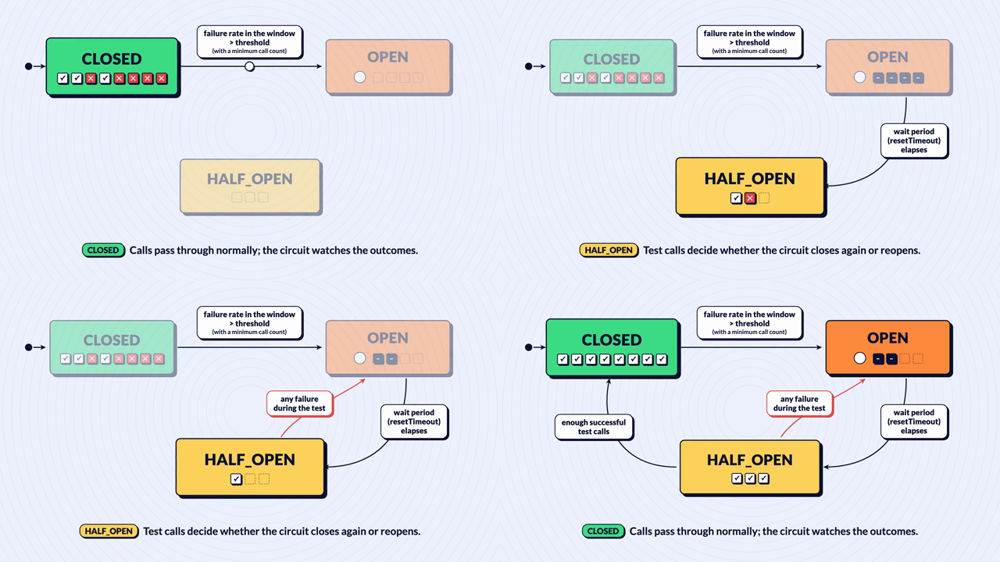

# brunosouzas-design-system

[](https://github.com/brunosouzas/brunosouzas-design-system/actions/workflows/ci.yml)
[](https://github.com/brunosouzas/brunosouzas-design-system/actions/workflows/openspec.yml)
[](LICENSE)

The visual identity of [brunosouzas.com](https://brunosouzas.com): design tokens, and animated explainers made with code.



## Contents

- [Status](#status)
- [What it is](#what-it-is)
- [How it works](#how-it-works)
- [Install](#install)
- [Commands](#commands)
- [How a scene is built](#how-a-scene-is-built)
- [Illustration pieces and covers](#illustration-pieces-and-covers)
- [Decisions](#decisions)
- [How this project is built](#how-this-project-is-built)
- [Security](#security)
- [Contributing](#contributing)
- [Licence](#licence)

## Status

Early. The first change of the [roadmap](docs/roadmap.md) is implemented: the token source and its CSS, TypeScript and JSON exports, the motion components, and the circuit-breaker state machine as the first catalogue scene (16:9 and 4:5, Portuguese and English), with commands to render its stills and videos. The first variety scene, `publish-subscribe`, is implemented with independent message copies, Publish acceptance, two ACKs and a local invoice NACK. Its owner stills/video approval is pending; implementation is not visual approval. The illustration pieces (roadmap item 3), the metro and diagram pieces (item 6) and stackledger's map markers, zones and icons (AB#167, 0.3.0) are implemented: the static drawing library that covers, banners, diagrams and scenes share, with a command that builds a blog cover from a JSON spec. The published covers are not ported to it yet (item 5).

## What it is

The blog's articles explain how systems behave: a circuit breaker opening, a pipeline promoting a build, a message being retried. Static diagrams show the states; an animation shows the change. This repository keeps both in one visual language, so a reader recognises the site in an article, on LinkedIn and on a slide.

- **Design tokens, one source.** Colours with fixed meanings (green healthy, orange blocked, yellow transitional, red the failure path), the Lato type scale, the thick ink outline, the hard offset shadow, radii, and motion timings. Exported as CSS variables for the site, TypeScript for the animations and JSON for anything else (the SVG generators of the static diagrams).
- **Motion components.** React components for [Remotion](https://www.remotion.dev): an ink block with a hard shadow, a pill label, an arrow that draws itself, a token travelling along a transition, call-result squares, a countdown ring. Flow primitives in `src/brand/flow-components.tsx` add a white hexagonal `Exchange`, rail-ended `Queue`, yellow-tab `TaggedContainer` and persistent `PositionedToken` (stationary or path-positioned). Copy identities, splits and ACK/NACK rules belong to scenes, not to a generic message engine.
- **Illustration pieces.** The objects the blog's covers and diagrams draw again and again (pill label, sheet, code panel, robot, server stack, gear, road, the 26 EIP icons and more), each a pure TypeScript function that returns an SVG node tree from the tokens. The same tree becomes an SVG file for a cover and React elements for a scene, and a scene animates a piece by recomputing its parameters every frame. See [Illustration pieces and covers](#illustration-pieces-and-covers).
- **A catalogue of scenes.** Each scene animates something a published article already says, in 16:9 (article) and 4:5 (LinkedIn), in Portuguese and English from one text table. The first is the [circuit-breaker state machine](docs/spikes/2026-10-22-motion-pilot/README.md).

The style follows the illustration covers of the [Spotify Engineering blog](https://engineering.atspotify.com/): flat shapes, a dark ink outline, a hard shadow with no blur, saturated colours on a calm page.

## How it works

```text
tokens/source.json ──► tokens/generated/tokens.css  ──► brunosouzas.com (site repository, planned)
                   ├─► tokens/generated/tokens.ts   ──► src/brand (motion components) ──► src/scenes ──► MP4 per format and language
                   └─► tokens/generated/tokens.json ──► other scripts

src/pieces (pure functions → SVG node tree) ──► toSvg   ──► covers (npm run cover), diagrams
                                            └─► toReact ──► Remotion scenes
```

The generated files are committed, so a consumer can read them without running Node. CSS custom properties carry the prefix `--ds-` (for example `--ds-color-ink`, `--ds-motion-pop-damping`) so they do not clash with the site's own theme names.

## Install

The tokens and the illustration pieces are published on npm as [`@brunosouzas/design-system`](https://www.npmjs.com/package/@brunosouzas/design-system), with provenance; releases follow [docs/release.md](docs/release.md). The package has no runtime dependency: Remotion, the motion components and the scenes stay in this repository.

```bash
npm install @brunosouzas/design-system
```

| Import | What it gives |
|---|---|
| `@brunosouzas/design-system` | the pieces, `toSvg`, `pose`, the cover spec helpers and `tokens` |
| `@brunosouzas/design-system/react` | `toReact`, for React and Remotion (needs `react` 19) |
| `@brunosouzas/design-system/tokens` | the typed `tokens` object |
| `@brunosouzas/design-system/tokens.css` | the `--ds-*` custom properties |
| `@brunosouzas/design-system/tokens.json` | the plain values |

```ts
import { pill, toSvg, tokens } from "@brunosouzas/design-system";
const label = pill({ x: 60, y: 30, text: "main" });
```

The package also installs the cover command as `brunosouzas-cover <spec.json> --out <file.svg>`.

## Commands

Requirements: Node.js 22.12 or later. Rendering also needs the network: Remotion downloads its headless browser on first use, and every render fetches Lato from Google Fonts.

```bash
npm ci                                            # install the pinned dependencies
npm run tokens                                    # validate tokens/source.json and write tokens/generated/
npm run tokens:check                              # fail if tokens/generated/ is stale (CI runs this)
npm run typecheck                                 # tsc over src/, scripts/ and test/
npm test                                          # unit and integration tests (no rendering, no network)
npm run stills -- circuit-breaker-states          # key-frame PNGs to out/stills/<composition>/<frame>.png
npm run render -- circuit-breaker-states          # out/master/<id>.mp4 and the web copy out/web/<id>.mp4
npm run stills -- publish-subscribe               # 24 phase/final PNGs (six per composition)
npm run stills -- publish-subscribe --dry-run     # print 24 commands, no effects
npm run render -- publish-subscribe --dry-run     # print eight commands; real video waits for owner stills approval
npm run build                                     # compile the package into dist/ (the package test needs it)
npm run cover -- cover.json --out card.svg        # build a blog cover (or a banner) from its spec
npm run pieces:sheet -- --out out/pieces.svg      # every piece once, labelled, for review
npm run studio                                    # Remotion Studio, for frame-by-frame review
```

- Change a token value in `tokens/source.json` and run `npm run tokens`; never edit `tokens/generated/` by hand. An invalid source prints every problem and writes nothing.
- `stills` and `render` take one scene name and an optional `--dry-run`, which prints the commands without running them. A render writes a hardware-encoded master (about 28 MB for 33 s) and an x264 web copy (under 1 MB) made with the ffmpeg bundled with Remotion, and prints one line per composition with its time and sizes. The four circuit-breaker clips take about four to five minutes on an Apple M3.
- Everything rendered goes to `out/`, which Git ignores.

## How a scene is built

The catalogue contains:

| Scene | Sources | Review status |
|---|---|---|
| `circuit-breaker-states` | [EN](https://brunosouzas.com/blog/circuit-breaker-in-mulesoft), [PT](https://brunosouzas.com/pt/blog/circuit-breaker-in-mulesoft) | approved pilot, unchanged |
| `publish-subscribe` | [EN](https://brunosouzas.com/wiki/publish-subscribe-in-mulesoft/), [PT](https://brunosouzas.com/pt/wiki/publish-subscribe-in-mulesoft/) and their Anypoint MQ diagrams | owner media gate pending |

Studio lists four compositions per scene in catalogue order. Pub-sub runs for 1000 frames at 30 fps, with the final 90 frames static. It depicts the article's AUTO acknowledgment case with a propagated invoice error, not every acknowledgment mode. Publish confirms exchange acceptance, not queue delivery. No redelivery is animated. After owner stills approval, `npm run render -- publish-subscribe` produces the four masters and four web copies; do not run it before that gate.

A scene lives in `src/scenes/<scene>/` with:

- `scene.ts`: the scene data, with no React: id, formats, languages, the timeline in frames, the text table per language (every string taken from the article) and the source article URL per language.
- `layout.ts`: one layout per format, in composition pixels; the 4:5 layout has its own arrow routes.
- `Scene.tsx`: the composition, which arranges the components from `src/brand/`.

`src/scenes/index.ts` lists the scenes and `src/Root.tsx` registers each one as a Studio folder with one composition per format and language (`<scene>-16x9-pt`, `-16x9-en`, `-4x5-pt`, `-4x5-en`). The tests check every registered scene: the same text keys in both languages, phases inside the composition and in order, events inside phases, and a reading hold of at least three seconds at the end.

`SceneContract<TTimeline>` supplies common metadata and phase ranges (`from`, `to`, events with `at`), duration and outro. `SceneData` remains the legacy state-machine alias with `Timeline`: states, slots, call results and transition fires retain their window checks. `CatalogueScene` also accepts `FlowSceneData` with `kind: "flow"`; it needs no active states or slots. The flow validator rejects unknown endpoints, invalid frames/ranges, trips crossing the outro, and impossible copy ownership/handoffs. There is no plug-in or graph-interpreter API.

Pub-sub separates `text.ts`, `timeline.ts` and pure `flow.ts` from its data entry. Half-open ownership intervals transfer each token atomically at split/arrival/ACK/NACK boundaries. Caption windows use phase ids internally, never as visible labels; captions and labels are frozen against source fixtures. Both media scripts consume only common phase ends and duration, without React or fonts.

The components take every colour and size from the tokens, and what is visible at a frame (arrow progress, travelling tokens, focus and dimming, captions, countdown, call results) comes from pure functions in `src/brand/motion.ts`, which the tests check without rendering.

## Illustration pieces and covers

`src/pieces/` holds the drawing library. A piece is a function from plain parameters to `{ body, text }`: `body` holds the shapes, drawn inside the outlined group, and `text` the words and glyphs, drawn after every shape so the outline never strokes a letter. Pieces read only the generated tokens and never a file, so a Remotion scene can import them.

- `toSvg(node)` writes a tree as SVG text; `toReact(node)` turns the same tree into React elements. Both describe the same elements, attributes and text, which the tests check.
- `pose(node, { x, y, tilt, squash, hop, scale, shake, opacity })` animates any piece around its base point; a scene recomputes the numbers every frame.
- Every colour parameter is a token path (`"color.healthy"`, `"illustration.accent"`), never a hex value, except the three data fills of the map pieces below. Each piece checks its parameters before drawing and names the first wrong one. Positions and points take any finite number, because a map has no edge; sizes stay within 10000. A drawing that would hold a non-finite number throws `<piece>: the drawing overflows`.
- The 41 pieces, with their anchors, parameters and defaults, are listed in [design §4](openspec/changes/archive/2026-10-23-illustration-pieces/design.md) (the 26 cover pieces), in [design §3](openspec/changes/archive/2026-10-23-metro-and-diagram-pieces/design.md) of `metro-and-diagram-pieces` (the nine map and diagram pieces) and in [design §3, §5 and §6](openspec/changes/archive/2026-10-23-stackledger-map-and-link-pieces/design.md) of `stackledger-map-and-link-pieces` (the six markers, zones and icons); the rules are in [`openspec/specs/illustration-pieces/`](openspec/specs/illustration-pieces/spec.md). `npm run pieces:sheet -- --out <file.svg>` draws them all.

### Maps and diagrams

Thirteen pieces draw a metro map and its page diagrams, for [stackledger](https://github.com/brunosouzas/stackledger) and any other map in this style: `lineBadge`, `stationMarker` (stop, interchange as a capsule, deprecated), `pipe`, `countBadge`, `nodeBlock`, `pillNode`, `hexNode` (normal, focus, placeholder), `messageArrow` (curved or straight, with a head and an optional label) `ledgerMark` (stackledger's mark; `surface: "dark"` lines it with a light rim), `renewalRing` (orange bands round a station), `suggestedHalo` (a dashed muted circle), `licenceMark` (a 10-unit disc, green when held, white to buy) and `zone` (the outline the caller gives, widened by a round 32-unit stroke at the surface's zone opacity, with an optional title). They paint what the caller lays out: positions, hulls, text measurement and truncation stay with the map engine.

- A `placeholder` node may have a `subtitle` (drawn like a normal node's, all muted), and `lineBadge` may have no `text` (the pill alone, 30 wide by default).
- The licence's disc is small, so it has its own room rule: `size` at least three outlines (9 at ink scale 1).

- `surface: "light" | "dark"` picks the background they sit on (`surface.*` tokens); every map and diagram piece takes it except `pipe`; `ledgerMark` takes only `surface`. On dark the hard shadow takes `surface.dark.shadow` and the outline gets a light rim ([ADR 0003](docs/adr/0003-visual-language-and-colour-meaning.md), amendment of AB#157).
- `inkScale` (0.25 to 8) thickens the outline, rim and shadow without changing the geometry, on `lineBadge`, `stationMarker`, `countBadge` and the three nodes; the map uses 1, the page diagrams 1.6. A shape's height (a marker's diameter) must be at least four outlines; a placeholder node, which draws no ink, is exempt.
- A line's colour comes from the map's data, so `pipe.fill`, `lineBadge.fill` and `zone.fill` also accept `#RRGGBB`. Every other colour is a token path, and a cover spec rejects any hex.
- The `map.*` tokens hold the measures (outline 3, shadow 3.5, line 12, casing 6, badge 20, node 46, ring 3, halo 1.5, licence 10, zone padding 32…), `surface.*.zoneOpacity` the zone's opacity (0.12, dark 0.22), and `site.*` the page palette, fonts and type scale of brunosouzas.com in light and dark.

```ts
import { lineBadge, pipe, stationMarker, toSvg } from "@brunosouzas/design-system";
const line = pipe({ d: "M20,40 L220,40", fill: "#7B3FE4" });
const stop = stationMarker({ cx: 120, cy: 40, surface: "dark" });
const badge = lineBadge({ x: 250, y: 40, text: "SH", fill: "#7B3FE4", surface: "dark" });
```

### A cover

A cover is a JSON spec kept with its article, outside this repository: drafts are private, and only the pieces are public. `npm run cover -- <spec.json> --out <file.svg>` validates it, reports every problem with its JSON path, and writes an 800x420 SVG; the same spec always gives the same bytes. With `"format": "banner"` the same command writes a site banner instead (see below).

```json
{
  "id": "sdd",
  "title": "A one-line request becomes a reviewed spec before any code",
  "description": "Illustration. On the left, a small slip …",
  "background": "blush",
  "rings": { "cx": 400, "cy": 220, "radius": 96 },
  "pieces": [
    { "piece": "speechBubble", "x": 52, "y": 174, "width": 160, "height": 74 },
    { "piece": "pill", "x": 132, "y": 174, "text": "request", "width": 104 }
  ]
}
```

- `background` names one of the 21 pairs in `coverBackground` (a background and its ring colour, measured from the published covers). Each pair is used by one cover only.
- `pieces` are drawn in order; their words go on top.
- The `rings` centre stays within ±10000 in a cover spec, and a piece that overflows is reported at its entry (`pieces[1]: the drawing overflows`).
- `custom` (optional) is the cover's one free-form object, a JSON node tree limited to drawing tags and a fixed list of attributes, with no external references. An object that repeats becomes a piece instead.
- The three published covers that proved the pieces are the test fixtures in `test/fixtures/covers/`.

### Banners

A spec with `"format": "banner"` (the default is `"cover"`) builds a home banner for a site: `banner.width` x `banner.height` (1200x420) with corners rounded at `banner.radius` (20), the measures of brunosouzas.com's published banner. Same pieces, validation and command. Two things differ from a cover:

- the rings go on until they reach the frame's farthest corner (22 rings for a centre at 600, 225 with radius 60), where a cover draws 14;
- pieces and labels are clipped to the rounded frame too, so nothing pokes past a corner.

The banner is one image that scales down as a whole. Words in it become small on a phone (a 19px label is about 6px at 375px wide), so keep them few or none. `test/fixtures/covers/home-banner.json` is the brunosouzas.com home banner redrawn from the pieces.

### A new piece

Add it to `src/pieces/library.ts` (or `src/pieces/metro.ts` for a map or diagram piece) with `definePiece(name, schema, draw)`, take its colours and sizes from the tokens (a new colour goes to `tokens/source.json` first), register it in `PIECES`, and give it a sample in `scripts/pieces-sheet.ts`. The catalogue test then checks that it draws with only its required parameters and uses token colours only.

### UI and link icons

- `uiIcon({ name, x, y, size, colour })` draws one of seven glyphs of the sites' chrome in a 24-unit box and one token colour: `sun`, `moon`, `zoomIn`, `zoomOut`, `reset`, `calendar`, `download` (data in `UI_ICONS`).
- `linkIcon({ icon, x, y, size, surface })` draws a link sticker as brunosouzas.com draws its social icons (46-unit box, light or dark frame): `github`, `linkedin`, `email`, `website` (data in `LINK_ICONS`). The GitHub mark is from [Font Awesome](https://fontawesome.com/), licensed [CC BY 4.0](https://creativecommons.org/licenses/by/4.0/).
- Neither holds a link, a style, a script or a URL, so a consumer can write one with `toSvg` inside its own `<svg xmlns=…>` and ship it as a static file.

```ts
import { el, linkIcon, toSvg } from "@brunosouzas/design-system";
const github = toSvg(el("svg", { xmlns: "http://www.w3.org/2000/svg", viewBox: "0 0 46 46", width: 28, height: 28 }, ...linkIcon({ icon: "github", x: 0, y: 0, surface: "dark" }).body));
```

### EIP icons

`src/pieces/eip-icons.ts` holds the 26 Enterprise Integration Patterns icons as data. They are redrawn from the icons by Gregor Hohpe and Bobby Woolf ([enterpriseintegrationpatterns.com](https://www.enterpriseintegrationpatterns.com/)), licensed [CC BY 4.0](https://creativecommons.org/licenses/by/4.0/); each icon keeps that credit in its description.

## Decisions

Project-wide decisions are recorded as ADRs in [`docs/adr/`](docs/adr/README.md).

- **Animations are code, made with Remotion.** A scene is React components and data, so a correction is a re-render and every format and language comes from one composition. AI video generators were rejected because their outputs are not consistent between clips. [ADR 0001](docs/adr/0001-remotion-for-motion.md)
- **One token source.** Colours, type, outline, shadow and motion timings live in one file; the site, the animations and the SVG scripts read generated exports instead of keeping their own copies. [ADR 0002](docs/adr/0002-one-token-source.md)
- **One visual language, fixed colour meanings.** Green is always healthy, orange always blocked, red always the failure path, so a reader learns the code once. Rotated text is allowed since the 2026-10-23 amendment. [ADR 0003](docs/adr/0003-visual-language-and-colour-meaning.md)
- **Scenes illustrate published articles.** Every string on screen comes from the article, so an animation never says more than the reviewed text. [ADR 0004](docs/adr/0004-scenes-illustrate-published-articles.md)

## How this project is built

- Changes are specified first with [OpenSpec](https://github.com/Fission-AI/OpenSpec): active changes in [`openspec/changes/`](openspec/changes/), the current behaviour in [`openspec/specs/`](openspec/specs/).
- Decisions: [`docs/adr/`](docs/adr/README.md).
- Order of work: [`docs/roadmap.md`](docs/roadmap.md).
- Evidence from experiments: [`docs/spikes/`](docs/spikes/).

## Security

No secrets, credentials or telemetry belong in this repository. Report a vulnerability privately: see [SECURITY.md](SECURITY.md).

## Contributing

Issues and pull requests are welcome, especially corrections and ideas for the components. The scenes illustrate the author's own articles, so new scenes come from the blog.

## Licence

Code and tokens: [Apache-2.0](LICENSE). The identity (the look of brunosouzas.com) is also the look of the author's other products, such as [stackledger](https://github.com/brunosouzas/stackledger), whose generated sites carry it. The licence does not grant use of the name or of the brunosouzas.com identity as someone else's brand: to build your own, fork it and change the token values.

The animations use [Remotion](https://www.remotion.dev), which has its own licence: free for individuals and for companies of up to three people, a company licence above that ([terms](https://www.remotion.dev/docs/license)). Check it before you render with this code at work.
