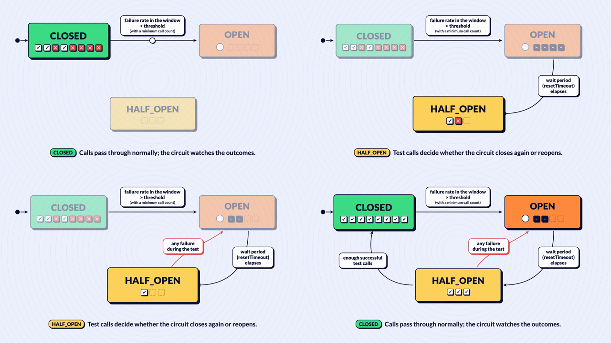

# brunosouzas-design-system

[](https://github.com/brunosouzas/brunosouzas-design-system/actions/workflows/ci.yml)
[](https://github.com/brunosouzas/brunosouzas-design-system/actions/workflows/openspec.yml)
[](LICENSE)

The visual identity of [brunosouzas.com](https://brunosouzas.com): design tokens, and animated explainers made with code.



## Contents

- [Status](#status)
- [What it is](#what-it-is)
- [How it works](#how-it-works)
- [Install](#install)
- [Commands](#commands)
- [How a scene is built](#how-a-scene-is-built)
- [Illustration pieces and covers](#illustration-pieces-and-covers)
- [Decisions](#decisions)
- [How this project is built](#how-this-project-is-built)
- [Security](#security)
- [Contributing](#contributing)
- [Licence](#licence)

## Status

Early. The first change of the [roadmap](docs/roadmap.md) is implemented: the token source and its CSS, TypeScript and JSON exports, the motion components, and the circuit-breaker state machine as the first catalogue scene (16:9 and 4:5, Portuguese and English), with commands to render its stills and videos. The first variety scene, `publish-subscribe`, is implemented with independent message copies, Publish acceptance, two ACKs and a local invoice NACK. Its owner stills/video approval is pending; implementation is not visual approval. The illustration pieces (roadmap item 3), the metro and diagram pieces (item 6) stackledger's map markers, zones and icons (AB#167, 0.3.0) and the body diagram pieces (AB#141, 0.3.2) are implemented: the static drawing library that covers, banners, diagrams and scenes share, with a command that builds a blog cover from a JSON spec. The published covers are not ported to it yet (item 5). Mira, the four pillar characters, the bank objects and the emotes are pieces too ([ADR 0007](docs/adr/0007-mira-and-the-pillar-cast.md)); new videos are language-neutral by default ([ADR 0005](docs/adr/0005-neutral-videos-and-the-cast.md)). Since 0.7.0 every piece follows one grammar ([ADR 0009](docs/adr/0009-one-piece-grammar.md)) and every written SVG carries its Source faces ([ADR 0008](docs/adr/0008-type-inside-the-image.md)); see [Upgrading to 0.7.0](#upgrading-to-070). 0.8.0 maps the site palette onto the brand roles and adds the category badges; see [Upgrading to 0.8.0](#upgrading-to-080). 0.8.1 adds stackledger's accent, retunes the city backdrop to the v2 neutrals and redraws `ledgerMark` as a white page; see [Upgrading to 0.8.1](#upgrading-to-081).

## What it is

The blog's articles explain how systems behave: a circuit breaker opening, a pipeline promoting a build, a message being retried. Static diagrams show the states; an animation shows the change. This repository keeps both in one visual language, so a reader recognises the site in an article, on LinkedIn and on a slide.

- **Design tokens, one source.** Colours with fixed meanings (green healthy, orange blocked, yellow transitional, red the failure path, under `color.state.*`), the brand palette, the Source type stacks (Source Sans 3, Source Code Pro, Source Serif 4), the thick ink outline, radii, and motion timings. Exported as CSS variables for the site, TypeScript for the animations and JSON for anything else (the SVG generators of the static diagrams).
- **Motion components.** React components for [Remotion](https://www.remotion.dev): an ink block, a pill label, an arrow that draws itself, a token travelling along a transition, call-result squares, a countdown ring. Flow primitives in `src/brand/flow-components.tsx` add a white hexagonal `Exchange`, rail-ended `Queue`, white-tab `TaggedContainer` and persistent `PositionedToken` (stationary or path-positioned). Copy identities, splits and ACK/NACK rules belong to scenes, not to a generic message engine.
- **Illustration pieces.** The objects the blog's covers and diagrams draw again and again (pill label, sheet, code panel, robot, server stack, gear, road, the 26 EIP icons and more), each a pure TypeScript function that returns an SVG node tree from the tokens. The same tree becomes an SVG file for a cover and React elements for a scene, and a scene animates a piece by recomputing its parameters every frame. See [Illustration pieces and covers](#illustration-pieces-and-covers).
- **A cast and emotes.** Mira and four pillar characters (Visor, Drone, Kiu, Sinal), six bank objects for scenery, and eight reaction symbols with a fixed meaning, so a video can tell its story without words. See [The cast and the emotes](#the-cast-and-the-emotes).
- **A catalogue of scenes.** Each scene animates something a published article already says. The first two are in 16:9 (article) and 4:5 (LinkedIn), in Portuguese and English from one text table; new scenes are one language-neutral 16:9 video ([ADR 0005](docs/adr/0005-neutral-videos-and-the-cast.md)). The first is the [circuit-breaker state machine](docs/spikes/2026-10-22-motion-pilot/README.md).

The style started from the illustration covers of the [Spotify Engineering blog](https://engineering.atspotify.com/) and, since 0.7.0, follows the brand's own grammar: flat shapes, one rounded ink outline, no hard shadow, white bodies on a warm page, one orange accent, and colour only where it means something ([ADR 0009](docs/adr/0009-one-piece-grammar.md)).

## How it works

```text
tokens/source.json ──► tokens/generated/tokens.css  ──► brunosouzas.com (site repository, planned)
                   ├─► tokens/generated/tokens.ts   ──► src/brand (motion components) ──► src/scenes ──► MP4 per format and language
                   └─► tokens/generated/tokens.json ──► other scripts

src/pieces (pure functions → SVG node tree) ──► toSvg   ──► covers (npm run cover), diagrams
                                            └─► toReact ──► Remotion scenes
```

The generated files are committed, so a consumer can read them without running Node. CSS custom properties carry the prefix `--ds-` (for example `--ds-color-ink`, `--ds-motion-pop-damping`) so they do not clash with the site's own theme names.

## Install

The tokens and the illustration pieces are published on npm as [`@brunosouzas/design-system`](https://www.npmjs.com/package/@brunosouzas/design-system), with provenance; releases follow [docs/release.md](docs/release.md). Its one runtime dependency is `harfbuzzjs`, pinned exactly, which subsets the fonts it ships in `fonts/` (Source Sans 3 and Source Code Pro, under the [SIL Open Font License](fonts/OFL.txt)); Remotion, the motion components and the scenes stay in this repository.

```bash
npm install @brunosouzas/design-system
```

| Import | What it gives |
|---|---|
| `@brunosouzas/design-system` | the pieces, `toSvg`, `pose`, the cover spec helpers and `tokens` |
| `@brunosouzas/design-system/react` | `toReact`, for React and Remotion (needs `react` 19) |
| `@brunosouzas/design-system/fonts` | `embedFonts`, for Node: embeds the Source faces a tree's text uses (reads `fonts/`, loads WebAssembly) |
| `@brunosouzas/design-system/tokens` | the typed `tokens` object |
| `@brunosouzas/design-system/tokens.css` | the `--ds-*` custom properties |
| `@brunosouzas/design-system/tokens.json` | the plain values |

```ts
import { pill, toSvg, tokens } from "@brunosouzas/design-system";
const label = pill({ x: 60, y: 30, text: "main" });
```

The package also installs the cover command as `brunosouzas-cover <spec.json> --out <file.svg>`.

### Type in a written image

An SVG shown through `` cannot load web fonts, so a written image carries its own: `embedFonts(tree)` adds one `<style>` after the `<desc>` with a `@font-face` per Source face the tree's text uses (the package ships Source Sans 3 Regular, Bold and Black, Source Code Pro Regular and Bold, and, since 0.9.0, Source Serif 4 Bold for `headline`), each a subset holding only the glyphs drawn ([ADR 0008](docs/adr/0008-type-inside-the-image.md)). The cover command and `npm run pieces:sheet` call it before they write; a tree without Source text is returned unchanged. It is async, reads only the faces it needs, and rejects naming the font file or `harfbuzzjs` when one fails to load. It lives in its own entry so the root entry stays importable in a browser. Its output is for written files and ``: when you inline a piece's SVG in an HTML page, skip `embedFonts` and let the page's fonts apply, because an inline `<style>` with `@font-face` applies to the whole document and would replace the page's Source faces with a subset.

```ts
import { coverTree, toSvg } from "@brunosouzas/design-system";
import { embedFonts } from "@brunosouzas/design-system/fonts";
const svg = toSvg(await embedFonts(coverTree(spec)));
```

## Commands

Requirements: Node.js 22.12 or later. Rendering also needs the network: Remotion downloads its headless browser on first use, and every render fetches Source Sans 3 and Source Code Pro from Google Fonts.

```bash
npm ci                                            # install the pinned dependencies
npm run tokens                                    # validate tokens/source.json and write tokens/generated/
npm run tokens:check                              # fail if tokens/generated/ is stale (CI runs this)
npm run typecheck                                 # tsc over src/, scripts/ and test/
npm test                                          # unit and integration tests (no rendering, no network)
npm run stills -- circuit-breaker-states          # key-frame PNGs to out/stills/<composition>/<frame>.png
npm run render -- circuit-breaker-states          # out/master/<id>.mp4 and the web copy out/web/<id>.mp4
npm run stills -- publish-subscribe               # 24 phase/final PNGs (six per composition)
npm run stills -- publish-subscribe --dry-run     # print 24 commands, no effects
npm run render -- publish-subscribe --dry-run     # print eight commands; real video waits for owner stills approval
npm run build                                     # compile the package into dist/ (the package test needs it)
npm run cover -- cover.json --out card.svg        # build a blog cover (or a banner, diagram or icon) from its spec
npm run pieces:sheet -- --out out/pieces.svg      # every piece once, labelled, for review
npm run pieces:sheet -- --out out/dark.svg --surface dark  # the same on the dark surface
npm run studio                                    # Remotion Studio, for frame-by-frame review
```

- Change a token value in `tokens/source.json` and run `npm run tokens`; never edit `tokens/generated/` by hand. An invalid source prints every problem and writes nothing.
- `stills` and `render` take one scene name and an optional `--dry-run`, which prints the commands without running them. A render writes a hardware-encoded master (about 28 MB for 33 s) and an x264 web copy (under 1 MB) made with the ffmpeg bundled with Remotion, and prints one line per composition with its time and sizes. The four circuit-breaker clips take about four to five minutes on an Apple M3.
- Everything rendered goes to `out/`, which Git ignores.

## How a scene is built

The catalogue contains:

| Scene | Sources | Review status |
|---|---|---|
| `circuit-breaker-states` | [EN](https://brunosouzas.com/blog/circuit-breaker-in-mulesoft), [PT](https://brunosouzas.com/pt/blog/circuit-breaker-in-mulesoft) | approved pilot, unchanged |
| `publish-subscribe` | [EN](https://brunosouzas.com/wiki/publish-subscribe-in-mulesoft/), [PT](https://brunosouzas.com/pt/wiki/publish-subscribe-in-mulesoft/) and their Anypoint MQ diagrams | owner media gate pending |

Studio lists four compositions per scene in catalogue order. Pub-sub runs for 1000 frames at 30 fps, with the final 90 frames static. It depicts the article's AUTO acknowledgment case with a propagated invoice error, not every acknowledgment mode. Publish confirms exchange acceptance, not queue delivery. No redelivery is animated. After owner stills approval, `npm run render -- publish-subscribe` produces the four masters and four web copies; do not run it before that gate.

A scene lives in `src/scenes/<scene>/` with:

- `scene.ts`: the scene data, with no React: id, formats, languages, the timeline in frames, the text table per language (every string taken from the article) and the source article URL per language.
- `layout.ts`: one layout per format, in composition pixels; the 4:5 layout has its own arrow routes.
- `Scene.tsx`: the composition, which arranges the components from `src/brand/`.

`src/scenes/index.ts` lists the scenes and `src/Root.tsx` registers each one as a Studio folder with one composition per format and language (`<scene>-16x9-pt`, `-16x9-en`, `-4x5-pt`, `-4x5-en`). The tests check every registered scene: the same text keys in both languages, phases inside the composition and in order, events inside phases, and a reading hold of at least three seconds at the end.

`SceneContract<TTimeline>` supplies common metadata and phase ranges (`from`, `to`, events with `at`), duration and outro. `SceneData` remains the legacy state-machine alias with `Timeline`: states, slots, call results and transition fires retain their window checks. `CatalogueScene` also accepts `FlowSceneData` with `kind: "flow"`; it needs no active states or slots. The flow validator rejects unknown endpoints, invalid frames/ranges, trips crossing the outro, and impossible copy ownership/handoffs. There is no plug-in or graph-interpreter API.

Pub-sub separates `text.ts`, `timeline.ts` and pure `flow.ts` from its data entry. Half-open ownership intervals transfer each token atomically at split/arrival/ACK/NACK boundaries. Caption windows use phase ids internally, never as visible labels; captions and labels are frozen against source fixtures. Both media scripts consume only common phase ends and duration, without React or fonts.

The components take every colour and size from the tokens, and what is visible at a frame (arrow progress, travelling tokens, focus and dimming, captions, countdown, call results) comes from pure functions in `src/brand/motion.ts`, which the tests check without rendering.

## Illustration pieces and covers

`src/pieces/` holds the drawing library. A piece is a function from plain parameters to `{ body, text }`: `body` holds the shapes, drawn inside the outlined group, and `text` the words and glyphs, drawn after every shape so the outline never strokes a letter. Pieces read only the generated tokens and never a file, so a Remotion scene can import them.

- `toSvg(node)` writes a tree as SVG text; `toReact(node)` turns the same tree into React elements. Both describe the same elements, attributes and text, which the tests check.
- `pose(node, { x, y, tilt, squash, hop, scale, shake, opacity })` animates any piece around its base point; a scene recomputes the numbers every frame.
- Every colour parameter is a token path (`"color.state.healthy"`, `"illustration.accent"`), never a hex value, except the three data fills of the map pieces below. Each piece checks its parameters before drawing and names the first wrong one. Positions and points take any finite number, because a map has no edge; sizes stay within 10000. A drawing that would hold a non-finite number throws `<piece>: the drawing overflows`.
- The 63 pieces, with their anchors, parameters and defaults, are listed in [design §4](openspec/changes/archive/2026-10-23-illustration-pieces/design.md) (the 26 cover pieces), in [design §3](openspec/changes/archive/2026-10-23-metro-and-diagram-pieces/design.md) of `metro-and-diagram-pieces` (the nine map and diagram pieces) and in [design §3, §5 and §6](openspec/changes/archive/2026-10-23-stackledger-map-and-link-pieces/design.md) of `stackledger-map-and-link-pieces` (the six markers, zones and icons) and in [design §3 to §5](openspec/changes/archive/2026-10-23-body-diagram-pieces/design.md) of `body-diagram-pieces` (the ten body diagram pieces), plus `stateStart` ([design §4](openspec/changes/archive/2026-10-24-designer-formats/design.md) of `designer-formats`) and `headline` (below); the rules are in [`openspec/specs/illustration-pieces/`](openspec/specs/illustration-pieces/spec.md). `npm run pieces:sheet -- --out <file.svg>` draws them all, and `--surface dark` draws every piece that takes `surface` on the dark surface.

### Maps and diagrams

Thirteen pieces draw a metro map and its page diagrams, for [stackledger](https://github.com/brunosouzas/stackledger) and any other map in this style: `lineBadge`, `stationMarker` (stop, interchange as a capsule, deprecated), `pipe`, `countBadge`, `nodeBlock`, `pillNode`, `hexNode` (normal, focus, placeholder), `messageArrow` (curved, straight or through two `controls` points, with a head and an optional label; `kind` `reply`, `failure` or `failFast` dashes it and paints it as ADR 0003 says; `heads: "start"` or `"both"` puts heads at `from`, `dashed` overrides the kind's dash), `ledgerMark` (stackledger's mark: a white page with one outline, ink on light and `surface.dark.muted` on `surface: "dark"`, with the bent line and two stations), `renewalRing` (orange bands round a station), `suggestedHalo` (a dashed muted circle), `licenceMark` (a 10-unit disc, green when held, white to buy) and `zone` (the outline the caller gives, widened by a round 32-unit stroke at the surface's zone opacity, with an optional title). They paint what the caller lays out: positions, hulls, text measurement and truncation stay with the map engine.

- A `placeholder` node may have a `subtitle` (drawn like a normal node's, all muted), and `lineBadge` may have no `text` (the pill alone, 30 wide by default).
- The licence's disc is small, so it has its own room rule: `size` at least three outlines (9 at ink scale 1).

- `surface: "light" | "dark"` picks the background they sit on (`surface.*` tokens); every map and diagram piece takes it except `pipe`; `ledgerMark` takes only `surface`. On dark, ink strokes on the background or on a dark face take `surface.dark.muted`, since ink vanishes on black; marks over a light or state fill stay ink ([ADR 0009](docs/adr/0009-one-piece-grammar.md)).
- `inkScale` (0.25 to 8) thickens the outline without changing the geometry, on `lineBadge`, `stationMarker`, `countBadge` and the three nodes; the map uses 1, the page diagrams 1.6. A shape's height (a marker's diameter) must be at least four outlines; a placeholder node, which draws no ink, is exempt.
- `countBadge` takes `textSize` (6 to 48, default 11): without `height`, the height, width and baseline grow with it.
- A line's colour comes from the map's data, so `pipe.fill`, `lineBadge.fill` and `zone.fill` also accept `#RRGGBB`. Every other colour is a token path, and a cover spec rejects any hex.
- `map.bendRadius` (32) is the radius of a bundle's centre line at a 45° or 90° bend; no piece reads it, the map engine draws the arcs (`pipe.d` takes `A`).
- The `map.*` tokens hold the measures (outline 3, shadow 0, line 12, casing 6, badge 20, node 46, ring 3, halo 1.5, licence 10, zone padding 32, bend radius 32…), `surface.*.zoneOpacity` the zone's opacity (0.12, dark 0.22), `surface.*.backdropWater`, `backdropWaterEdge`, `backdropPark` and `backdropCredit` the colours of a city backdrop behind a map and its OpenStreetMap credit (no piece draws it; stackledger does): since 0.8.1 the v2 neutrals, water `#C7DAEA` / `#1C2733`, its edge `#A9C4DA` / `#2A3846`, parks `#D6E4CF` / `#1A241D`, and the credit the muted text role, `brand.<theme>.textMuted` (`#5C5852` / `#ADA79D`), checked equal by a test. `site.*` holds the page palette, fonts and type scale of brunosouzas.com in light and dark. Since 0.8.0 each `site` colour is the brand role it stands for (ADR 0006, amended): `primary`, `dark`, `text` and `textDark` are `brand.<theme>.text`, `body` is `bg`, `light` is `cardBg`, `border` is `border`, `textLight` is `textMuted` and `link` is `accentText`; `site.font` names Source Sans 3 (`primary`), Source Serif 4 (`secondary`) and Source Code Pro (`mono`). Against body text a link is 3.25:1 in light and 2.23:1 in dark, so a page keeps its link underline: colour alone does not mark a link (WCAG 1.4.1). `brand.<theme>.stackledgerAccent` (`#3B5BDB` / `#7D8CFF`, `--ds-brand-<theme>-stackledger-accent`) is stackledger's product accent, at least 4.5:1 on `site.<theme>.body` and `site.<theme>.light` (ADR 0006, amended 2026-11-07); no piece draws it by default, a spec names it where the product's line is meant (`pipe` `fill: "brand.light.stackledgerAccent"`).

```ts
import { lineBadge, pipe, stationMarker, toSvg } from "@brunosouzas/design-system";
const line = pipe({ d: "M20,40 L220,40", fill: "#7B3FE4" });
const stop = stationMarker({ cx: 120, cy: 40, surface: "dark" });
const badge = lineBadge({ x: 250, y: 40, text: "SH", fill: "#7B3FE4", surface: "dark" });
```

### Body diagrams

Ten pieces draw what the blog's body diagrams need beyond the map pieces: `diagramBox` (a box or pill with a fill and centred lines), `decisionNode` (diamond), `storeNode` (cylinder), `queueNode` (box with two rails), `exchangeNode` (hexagon), `taggedContainer` (a frame with its name on a tab), `lifeline` (dashed, or sparse dots once nothing calls it), `phaseBand` (a pill across a sequence in its state's colour), `altFrame` (alt/else frame with a tag and condition per part) and `edgeLabel` (words next to an arrow, optionally on a backdrop). They take `surface` and, the stickers, `inkScale`, like the map pieces, and paint what the caller lays out.

- The shapes take one to three centred lines (`text`), an optional `subtitle` and `textSize`. Without `fill` the face is the surface's panel; with a fill, every word is ink.
- Backticks mark code: `` "adopts a `correlationId`" `` draws `correlationId` in the monospace stack, as a `tspan`. An odd number of backticks is drawn as is. The cover `pill` follows the same rule (`` "`main`" ``).
- `milestonePin` takes `size`, the head's radius (6 to 48, default 18); the head, its outline and the label scale with it.
- Widths the piece estimates (`tagWidth`, `conditionWidth`, a label's `width`) can be passed by a caller that measures its text.
- A body diagram is 800 wide. Lay it out in 560 units and show it 800 wide: the pieces then come out at the sizes of the published diagrams (text about 18, outline about 4). The cover command does this for you with `"format": "diagram"` (below).
- `stateStart({ cx, cy, r, surface })` draws the filled start dot of a state machine (7.7 units, 11 at 800), in the surface's text colour, with no outline and no shadow.

### The cast and the emotes

The cast of [ADR 0007](docs/adr/0007-mira-and-the-pillar-cast.md) shares one skin (white body, ink outline, a near-black visor with the amber idle eyes, `cast.eyes`); a character's identity is its shape, never a colour. Each takes `x`, `y` (the centre of its ground line), `scale`, `surface`, `expression` (`idle`, `done`, `waiting`, `failed`) and `view` (`front`, `back`):

- `mira(…)`: the protagonist, an astrolabe with a screen face; `needleAngle` points the route, `carries` rides a message on the needle's tip.
- `visor` (AI engineering; `holds`, `points`), `drone` (delivery; `carries`), `kiu` (wiki and series; `steps`), `sinal` (stackledger, without the parent-brand hood tip).
- `bankObject({ name, x, y, scale, surface })`: six objects for scenery, `courier`, `lume`, `carga`, `anel`, `modulo`, `hub`, with the cast's idle eyes on their screen and no expression.

`emote({ kind, x, y, scale, burst, surface })` draws a reaction beside a head, never over the face. Each kind keeps one meaning in every video, like the colours:

| `kind` | Shape | Meaning |
|---|---|---|
| `idea` | amber bulb with rays | an idea |
| `doubt` | ? | doubt, not understood |
| `problem` | ! in a red triangle | a problem appears |
| `worked` | green check | it worked |
| `refused` | red cross | refused |
| `pressure` | white sweat drops | under pressure |
| `liked` | heart in the accent | liked |
| `waiting` | white Z Z Z | waiting |

In a scene, an emote pops in on the frame the face changes (`emotePop` in `src/brand/cast-motion.ts`, with `leave`, `blinking`, `breathe`, `squashAfter` and `hop`), one at a time, and the body acts through `pose`. On a dark page pass `surface: "dark"`: the outlines, rays and Z casings take `surface.dark.muted`, the marks over a fill stay ink.

### A cover

A cover is a JSON spec kept with its article, outside this repository: drafts are private, and only the pieces are public. `npm run cover -- <spec.json> --out <file.svg>` validates it, reports every problem with its JSON path, and writes an 800x420 SVG; the same spec always gives the same bytes. With `"format": "banner"` the same command writes a site banner instead (see below).

```json
{
  "id": "sdd",
  "title": "A one-line request becomes a reviewed spec before any code",
  "description": "Illustration. On the left, a small slip …",
  "background": "trackAi",
  "rings": { "cx": 400, "cy": 220, "radius": 96 },
  "pieces": [
    { "piece": "speechBubble", "x": 52, "y": 174, "width": 160, "height": 74 },
    { "piece": "pill", "x": 132, "y": 174, "text": "request", "width": 104 }
  ]
}
```

- `background` names one pair in `coverBackground` (a background and its ring colour). Since 0.7.0 the pairs are track families (ADR 0006, amended 2026-11-06): each track has a default `track<Name>` and named tones `<track><Tone>`, and each article picks one tone of its track, so a series varies and the track stays recognisable; `neutral` (the brand background) is for a cover with no track. These twelve are the only pairs. Which cover takes which tone is the `illustration` skill's rule, not the package's.

  | Track | Name | Tone | Fill | Ring |
  |---|---|---|---|---|
  | Integration | `trackIntegration` | peach, default | `#F7C6A1` | `#E3AB84` |
  | Integration | `integrationClay` | clay | `#E9CDBE` | `#D3B3A3` |
  | Integration | `integrationSand` | sand | `#EED7A8` | `#D8BF8C` |
  | Delivery | `trackDelivery` | sage, default | `#B9DEC3` | `#98C6A5` |
  | Delivery | `deliveryMint` | mint | `#A9DCD6` | `#88C4BD` |
  | Delivery | `deliveryOlive` | olive | `#D3DFA8` | `#B9C78A` |
  | AI | `trackAi` | periwinkle, default | `#C5CDF2` | `#A5AEDA` |
  | AI | `aiSky` | sky | `#B5D5F2` | `#94BBDE` |
  | AI | `aiLilac` | lilac | `#DCC7F0` | `#C3A9DC` |
  | Personal tools | `trackPersonal` | butter, default (new) | `#F4DD8E` | `#DDC46C` |
  | Personal tools | `personalRose` | rose | `#F5C9DA` | `#E0ABC0` |
  | no track | `neutral` | cream (unchanged) | `#F6F3EC` | `#D8D6D0` |

- `pieces` are drawn in order; their words go on top.
- The `rings` centre stays within ±10000 in a cover spec, and a piece that overflows is reported at its entry (`pieces[1]: the drawing overflows`).
- `custom` (optional) is the cover's one free-form object, a JSON node tree limited to drawing tags and a fixed list of attributes, with no external references. An object that repeats becomes a piece instead. It is painted after every piece's shapes; `customAt: <i>` paints it before `pieces[i]` instead, so a pill can sit on top of it (words always stay on top).
- The three published covers that proved the pieces are the test fixtures in `test/fixtures/covers/`.

### Banners

A spec with `"format": "banner"` (the default is `"cover"`) builds a home banner for a site: `banner.width` x `banner.height` (1200x420) with corners rounded at `banner.radius` (20), the measures of brunosouzas.com's published banner. Same pieces, validation and command. Two things differ from a cover:

- the rings go on until they reach the frame's farthest corner (22 rings for a centre at 600, 225 with radius 60), where a cover draws 14;
- pieces and labels are clipped to the rounded frame too, so nothing pokes past a corner.

The banner is one image that scales down as a whole. Words in it become small on a phone (a 19px label is about 6px at 375px wide), so keep them few or none. `test/fixtures/covers/home-banner.json` is the brunosouzas.com home banner redrawn from the pieces.

### Signature lockup

A cover, banner, LinkedIn card or og spec takes an optional `"signature": true`: Mira (scale 0.25) and the symbol, anchored to the frame's bottom-right corner by `cover.signatureMargin` from both edges. Omit it and nothing is added. A diagram, favicon, avatar or icon spec refuses the key (an icon accepted it and drew nothing before 0.7.0).

### Social and platform formats

Four more formats hold the symbol or a reduced cover frame, fixed size, no `height`:

- `"format": "linkedin-card"` — 1080x1080, cover frame conventions (`background`, `rings`, `pieces`, `custom`, `signature`). The "new piece" announcement card.
- `"format": "og"` — 1200x630, cover frame conventions. The site's generic social-preview image (not an article's own cover, which already serves as its og:image).
- `"format": "favicon"` — 32x32, no `pieces`: the symbol drawn twice, a light-theme group and a dark-theme group switched by a `prefers-color-scheme` media query. This command writes the SVG only; a favicon PNG set (16/32/48/180/192/512) is the consuming site's own build step.
- `"format": "avatar"` — 500x500, no `background`, no `pieces`: the symbol filling the frame on an accent-coloured ground. One static image (GitHub profile, etc.), not theme-switching.

### Body diagrams and icons from a spec

The same command draws the blog's body diagrams and icons, so a consumer needs no script and no local install:

```sh
npx --yes --package @brunosouzas/design-system@<version> brunosouzas-cover design/<topic>.json --lang pt --out images/<topic>-pt.svg
```

- `"format": "diagram"` takes a `height` in layout units (1 to 10000) and no `background`: the spec is laid out 560 wide and written 800 wide, on the `color.panel` panel with rounded corners (`bodyDiagram.radius`, 14 at 800) and rings in `color.ring` that show at step 28 and width 2, out to the farthest corner. Pieces get the map outline (3) and label size (13), which show at 4.3 and 18.6. `test/fixtures/covers/circuit-breaker-states.json` is the circuit breaker article's state diagram.
- `"format": "icon"` holds one `eipIcon`, `uiIcon`, `linkIcon` or `categoryIcon` at 0,0 and writes it in a box of its own size (64x40 for an EIP icon, 42 × `scale` for a category badge). An EIP icon takes its title and description, with the CC BY 4.0 credit, from the icon's data, so its spec has neither; a UI, link or category icon spec needs both. No `background`, `rings`, `custom` or `signature`.
- **Text tables.** `"text": { "pt": { "open": ["taxa de falha", "> limite"] }, "en": { ... } }` holds one table per language with the same keys; any string `"@open"` elsewhere in the spec (pieces, `title`, `description`, even `id`) is replaced by that key's value for the language passed with `--lang <code>`. Every language must define every key, and the ids in the output gain the language (`<id>-pt`). Without `text`, strings are drawn as written, so `"@home"` stays a label.
- Like a cover, a diagram or icon is a standalone image: `uiIcon` `colour: "currentColor"` is refused in every format.

### Titles

`headline({ x, y, lines, size, anchor, surface })` writes a title of one to four `lines` in Source Serif 4 Bold (`font.serif`), the first baseline at (`x`, `y`), the next ones 1.1 × `size` lower; `size` is an integer from 24 to 160 (default 64), `anchor` is `start` (default), `middle` or `end`, and the colour is `brand.<surface>.text`. It draws only words (`text`), so a cover, banner, LinkedIn card, og or diagram spec writes it outside the outlined group, and the written image embeds the serif subset. With `text` tables, `"lines": "@slogan"` takes a line array per language. `test/fixtures/covers/og-headline.json` is brunosouzas.com's default share image.

### A new piece

Add it to `src/pieces/library.ts` (or `src/pieces/metro.ts` for a map or diagram piece) with `definePiece(name, schema, draw)`, take its colours and sizes from the tokens (a new colour goes to `tokens/source.json` first), register it in `PIECES`, and give it a sample in `scripts/pieces-sheet.ts`. The catalogue test then checks that it draws with only its required parameters and uses token colours only.

### UI and link icons

- `uiIcon({ name, x, y, size, colour })` draws one of seven glyphs of the sites' chrome in a 24-unit box and one token colour: `sun`, `moon`, `zoomIn`, `zoomOut`, `reset`, `calendar`, `download` (data in `UI_ICONS`). `colour: "currentColor"` makes the icon follow its element's text colour (a button that inverts on hover, say); it only works when the SVG is inline in the page, since an `` does not inherit the page's colour, and a cover spec refuses it.
- `linkIcon({ icon, x, y, size, surface })` draws a link sticker in a 46-unit box, a white face with its outline and no frame (on dark the outline takes `surface.dark.muted`): `github`, `linkedin`, `email`, `website` (data in `LINK_ICONS`). The GitHub mark is from [Font Awesome](https://fontawesome.com/), licensed [CC BY 4.0](https://creativecommons.org/licenses/by/4.0/).
- `categoryIcon({ category, x, y, scale })` draws the site's category badge in a 42-unit box: a disc in the default tone of the category's track (`coverBackground.<track>.fill`, ringed in its `.ring`) with a glyph on it, the same on light and dark pages. `integration` (`trackIntegration`, the notation's `pointToPointChannel`), `delivery` (`trackDelivery`, `gateToProduction`), `aiEngineering` (`trackAi`, `contextWindow`), `personalTools` (`trackPersonal`, its own wrench and screwdriver); names in `CATEGORY_ICON_NAMES`. At `scale` 4 it is the 168-pixel badge the site shows.
- None holds a link, a style, a script or a URL, so a consumer can write one with `toSvg` inside its own `<svg xmlns=…>` and ship it as a static file.

```ts
import { el, linkIcon, toSvg } from "@brunosouzas/design-system";
const github = toSvg(el("svg", { xmlns: "http://www.w3.org/2000/svg", viewBox: "0 0 46 46", width: 28, height: 28 }, ...linkIcon({ icon: "github", x: 0, y: 0, surface: "dark" }).body));
```

### EIP icons

`src/pieces/eip-icons.ts` holds the 26 Enterprise Integration Patterns icons as data. They are redrawn from the icons by Gregor Hohpe and Bobby Woolf ([enterpriseintegrationpatterns.com](https://www.enterpriseintegrationpatterns.com/)), licensed [CC BY 4.0](https://creativecommons.org/licenses/by/4.0/); each icon keeps that credit in its description.

## Upgrading to 0.9.0

0.9.0 (card 307) adds a serif title. Nothing is removed or renamed, and every 0.8.1 spec builds byte-identical.

| Added | What |
|---|---|
| `headline` | a title in Source Serif 4 Bold, one to four lines (see Titles, above); `PIECES` has 63 names, so a check of the exact list must add it |
| `fonts/SourceSerif4-Bold.ttf` | Adobe's Source Serif 4 4.005R Bold, unmodified, its SHA-256 pinned; an image embeds only the glyphs it draws ([ADR 0008](docs/adr/0008-type-inside-the-image.md), amended) |

## Upgrading to 0.8.1

0.8.1 (card 303) adds stackledger's product layer. Nothing is removed or renamed; images and pages that use the backdrop tokens or `ledgerMark` change appearance on rebuild.

| Changed | Before | Now |
|---|---|---|
| `brand.light.stackledgerAccent`, `brand.dark.stackledgerAccent` (`--ds-brand-<theme>-stackledger-accent`) | absent | `#3B5BDB`, `#7D8CFF`; a check of the exact list of brand roles must add it |
| `surface.light.backdropWater`, `backdropWaterEdge`, `backdropPark`, `backdropCredit` | `#C9D8FF`, `#B5C7F5`, `#D4F2DF`, `#5A6385` | `#C7DAEA`, `#A9C4DA`, `#D6E4CF`, `#5C5852` |
| `surface.dark.backdropWater`, `backdropWaterEdge`, `backdropPark`, `backdropCredit` | `#1E3175`, `#2A3F8A`, `#183F52`, `#9AA6D6` | `#1C2733`, `#2A3846`, `#1A241D`, `#ADA79D` |
| `ledgerMark` | an ink square (on dark, lined by a band in `surface.dark.muted`) | a white page with one outline, ink on light and `surface.dark.muted` on dark |

## Upgrading to 0.8.0

0.8.0 (card 302) changes what the site palette holds and the category icon's call.

| Changed | Before | Now |
|---|---|---|
| `site.light.*`, `site.dark.*` colours (`--ds-site-*`) | the Astroplate palette (`body` `#FFFFFF` / `#1C1C1C`, `text` `#444444` / `#B4AFB6`…) | the brand roles above (`body` `#F6F3EC` / `#121110`, `text` `#121212` / `#F1EEE8`…); same names |
| `site.light.link`, `site.dark.link`, `site.font.mono` | absent | `#B83A0C`, `#FF7A45`, `'Source Code Pro', monospace` |
| `categoryIcon` | `personalTools` only, a glyph with `surface` | four category badges on a track-tone disc; `surface` is refused |
| `icon` format | `eipIcon`, `uiIcon`, `linkIcon` | also `categoryIcon` |

A page that reads `--ds-site-*` changes colour when it moves to 0.8.0. With `primary` equal to `text`, a hover that turns text-coloured links `primary` no longer shows: move it to `link`.

## Upgrading to 0.7.0

0.7.0 is a breaking release (cards 300 and 301). Rebuild every image once on it; the output changes appearance (ADR 0009) and carries its fonts (ADR 0008).

| Removed | Use instead |
|---|---|
| `color.healthy`, `color.blocked`, `color.transitional`, `color.caller`, `color.backend`, `color.failure`, `color.failFast` (and their `--ds-color-*` variables) | the same values at `color.state.*` (`--ds-color-state-*`); a spec that passes `"color.healthy"` is refused, pass `"color.state.healthy"` |
| the 21 `coverBackground` pairs from before 0.6.0 (`blush`, `peach`, `lavender`, `navy`, `mustard`, …) | a tone of the cover's track family (`trackIntegration`, `integrationClay`, `deliveryMint`, `aiSky`, `trackPersonal`, … see "Cover spec") or `neutral` |
| `mascot`, `MASCOTS`, `MASCOT_ACTIONS`, `MASCOT_FACES`, the types `MascotName`, `MascotFace`, `MascotAction`, `MascotParams` and the seven-role `cast.*` colours | Mira, the pillar characters or a bank object (ADR 0007); `emote` and `EMOTE_KINDS` stay |
| `illustration.healthyShade`, `illustration.transitionalShade` | nothing reads them; pass a token path if a drawing needs a shade |
| `"signature"` in an icon spec | remove it (it drew nothing) |
| the `cast-motion-test` composition | none; the cast timing helpers in `src/brand/cast-motion.ts` stay |

Other changes a consumer sees: `font.sans` and `font.mono` name Source Sans 3 and Source Code Pro first, and the new `font.serif` names Source Serif 4; `cover.labelWeight` is 700 (Source Sans 3 has no static 800); the `shadow` tokens and `map.shadow` are 0; `color.ink`, `color.panel`, `color.ring`, `illustration.*` and `surface.*` take the v2 values; several pieces have new defaults (a white `taggedContainer` tab, an ink `arcArrow`, white bodies), listed in [ADR 0009](docs/adr/0009-one-piece-grammar.md) and the change's design.

## Decisions

Project-wide decisions are recorded as ADRs in [`docs/adr/`](docs/adr/README.md).

- **Animations are code, made with Remotion.** A scene is React components and data, so a correction is a re-render and every format and language comes from one composition. AI video generators were rejected because their outputs are not consistent between clips. [ADR 0001](docs/adr/0001-remotion-for-motion.md)
- **One token source.** Colours, type, outline, shadow and motion timings live in one file; the site, the animations and the SVG scripts read generated exports instead of keeping their own copies. [ADR 0002](docs/adr/0002-one-token-source.md)
- **One visual language, fixed colour meanings.** Green is always healthy, orange always blocked, red always the failure path, so a reader learns the code once. Rotated text is allowed since the 2026-10-23 amendment. [ADR 0003](docs/adr/0003-visual-language-and-colour-meaning.md)
- **Scenes illustrate an approved source.** Every string on screen comes from a published article, or from a post or page the owner approved, so a scene or piece never says more than the reviewed text. Catalogue scenes still come from published articles. [ADR 0004](docs/adr/0004-scenes-illustrate-published-articles.md)
- **Neutral videos, told by a fixed cast.** One video for both languages, no words on screen, a caption only when the motion cannot explain itself, and every gesture tied to an article line. [ADR 0005](docs/adr/0005-neutral-videos-and-the-cast.md)
- **Three token layers.** Primitive, semantic and component tokens, with the brand palette measured for AA contrast in both themes and the states under `color.state.*`. [ADR 0006](docs/adr/0006-three-layer-tokens-and-brand-colour.md)
- **Mira and the pillar cast.** A protagonist and four pillar characters replace the engineering-role cast. [ADR 0007](docs/adr/0007-mira-and-the-pillar-cast.md)
- **Type inside the image.** Every written SVG embeds a subset of the Source faces its text uses, so readers see Source through ``. [ADR 0008](docs/adr/0008-type-inside-the-image.md)
- **One piece grammar.** No hard shadow, white bodies, one accent, colour only where it means something, ink muted on dark; a test checks every piece. [ADR 0009](docs/adr/0009-one-piece-grammar.md)

## How this project is built

- Changes are specified first with [OpenSpec](https://github.com/Fission-AI/OpenSpec): active changes in [`openspec/changes/`](openspec/changes/), the current behaviour in [`openspec/specs/`](openspec/specs/).
- Decisions: [`docs/adr/`](docs/adr/README.md).
- Order of work: [`docs/roadmap.md`](docs/roadmap.md).
- Evidence from experiments: [`docs/spikes/`](docs/spikes/).

## Security

No secrets, credentials or telemetry belong in this repository. Report a vulnerability privately: see [SECURITY.md](SECURITY.md).

## Contributing

Issues and pull requests are welcome, especially corrections and ideas for the components. The scenes illustrate the author's own articles, so new scenes come from the blog.

## Licence

Code and tokens: [Apache-2.0](LICENSE). The identity (the look of brunosouzas.com) is also the look of the author's other products, such as [stackledger](https://github.com/brunosouzas/stackledger), whose generated sites carry it. The licence does not grant use of the name or of the brunosouzas.com identity as someone else's brand: to build your own, fork it and change the token values.

The animations use [Remotion](https://www.remotion.dev), which has its own licence: free for individuals and for companies of up to three people, a company licence above that ([terms](https://www.remotion.dev/docs/license)). Check it before you render with this code at work.
