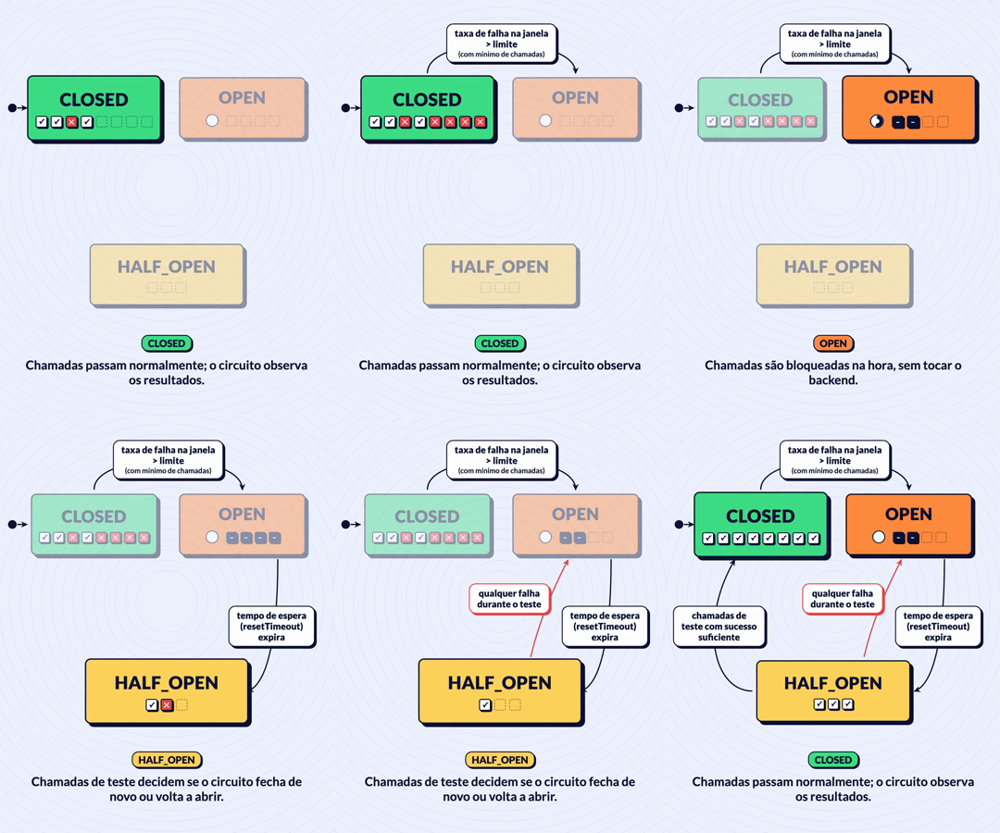

# Spike: motion pilot (2026-10-22)

**Question.** Can the blog's static diagram style (flat shapes, ink outline, hard shadow, semantic colours) become animated explainers made with code, consistent across formats and languages, with an AI coding agent writing the code and the author directing?

**Scene.** The circuit-breaker state machine from the article [Circuit Breaker in MuleSoft: When Retry Makes Things Worse](https://brunosouzas.com/blog/circuit-breaker-in-mulesoft) (states CLOSED, OPEN, HALF_OPEN and their four transitions). Every string comes from the published article and its diagram labels.

## What was built

A throwaway Remotion 4 project with:

- `tokens.ts`: colours with semantic names, outline, shadow, radius, font, and motion tokens (pop spring, focus spring, arrow-draw frames, token-travel frames, dim opacity, reading hold).
- `components.tsx`: ink block with hard shadow, pill, self-drawing arrow, travelling token, call-result square, countdown ring, rings background.
- The scene: `text.ts` (PT and EN), `timeline.ts` (phases in frames), `layout.ts` (one layout per format) and the composition.

The story runs one full loop: CLOSED collects call results until failures cross the threshold; OPEN blocks calls while the reset timeout runs down; HALF_OPEN first fails a test call and reopens, then passes enough test calls and closes. A caption shows the article's sentence for the active state. The last frame holds for three seconds.

## Findings

- **It works, and the author approved the pilot with no changes.** The style survives animation; the caption helps muted playback.
- **Stills before video.** Rendering one frame per phase and fixing overlaps before the full render saved full renders.
- **Each format needs its own layout.** Scaling the 16:9 layout into 4:5 does not work; the 4:5 arrows need their own routes.
- **Layer order matters.** Arrows, blocks, travelling tokens, pills, caption. A pill sitting on the straight part of an arrow hides the token for most of its trip.
- **Contrast inside blocks.** Small elements filled with the block's own hue disappear (orange squares inside the orange OPEN block); ink or white works.
- **Render cost.** A 33-second clip takes about 70 to 130 seconds on an Apple M3 with the hardware encoder. The hardware encoder writes large files (about 28 MB per clip); a second x264 pass (CRF 30) gives about 0.9 MB with no visible loss, which is what a web page should load.
- **Licence.** Remotion is free for individuals and companies of up to three people; larger companies need a company licence.

## What carries into the first change

The tokens, the components, the scene and the render script, with tests for the token exports and the timeline, and the token source moved to one file exported to CSS, TypeScript and JSON.
